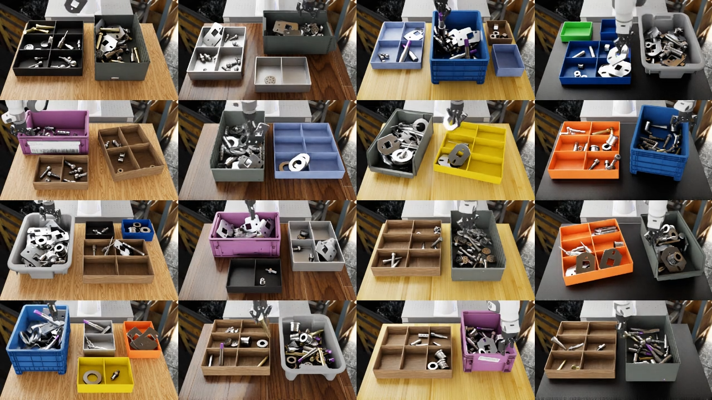

# Franka parts sorting in NVIDIA Isaac Lab

**sorting planner · learned tool-pose tracker · damped least-squares IK · 8-D joint targets**

[](https://docs.omniverse.nvidia.com/isaacsim/latest/overview.html)
[](https://isaac-sim.github.io/IsaacLab)
[](https://docs.python.org/3/whatsnew/3.12.html)
[](https://github.com/leggedrobotics/rsl_rl)
[](LICENSE)



**task-franka-sorting** is a [Nepher Robotics](https://github.com/nepher-ai) extension for [NVIDIA Isaac Lab](https://isaac-sim.github.io/IsaacLab) / [Isaac Sim](https://docs.omniverse.nvidia.com/isaacsim/latest/overview.html). It runs a **Franka** arm with a **Robotiq 2F-85** gripper that picks industrial parts out of a bin or crate and sorts them into the cells of a parts tray. Each cell takes one part type. The mapping is random per task and stated in the instruction. A sorting planner chooses each grasp and place. An **RSL-RL PPO** policy tracks that tool pose. **Damped least-squares IK** turns the tracker action into **8-D absolute joint targets**.

| | |
|---|---|
| **Robot** | Franka with a Robotiq 2F-85 gripper |
| **Simulator** | NVIDIA Isaac Sim 6.1.0 + Isaac Lab 3.0 |
| **Algorithm** | rsl_rl PPO tool-pose tracker |
| **Stack** | Sorting planner → PPO tracker → damped least-squares IK → 8-D joint targets |
| **Rates** | Physics 240 Hz. Commands every 16 steps (15 Hz) |
| **Tracker observation** | 43 values: arm position and velocity, gripper, tool pose, pose error, pose target, grip target, last action |
| **Tracker action** | 7-D tool-pose delta plus gripper, integrated to absolute joint targets |
| **Joint action** | 8 values: 7 absolute joint targets [rad], gripper 0 (open) or 1 (closed) |
| **License** | BSD 3-Clause |

## How it runs

```
sorting planner (SortingPlanner) -> learned tool-pose tracker (ll_policy) -> damped-least-squares IK -> 8-D joint targets
```

Train the tracker first, then play the planner on top of that checkpoint.

- **High level.** `SortingPlanner` picks one part at a time out of the container and sets it into its tray cell. Motion is a rest-to-rest polyline, so the tool cruises at the speed the evaluator rewards and stops at the grasp and at the release. Every placement is checked against the benchmark `in_cell` predicate. A part that leaves its cell is picked up again.
- **Low level.** The PPO policy tracks the planner's tool pose and gripper command. Its 7-D action is a tool-pose delta plus the gripper. `IkJointCommandAction` turns that into absolute joint targets, the same 8-D action space a downstream policy writes. Training uses 4096 envs, observation noise, and an 8 s episode. About 35% of the pose targets are level, leaning, or pitched, so the tracker keeps the poses the planner uses at the edge of the workspace.

## Gym environments

| Id | Use |
| --- | --- |
| `Nepher-FrankaSorting-LL-v0` | Train the tracker (4096 envs, observation noise) |
| `Nepher-FrankaSorting-LL-Play-v0` | Play the tracker (32 envs, no noise) |
| `Nepher-FrankaSorting-HL-Play-v0` | Planner plus tracker on every selected task in one stage. Loads the latest tracker checkpoint |
| `Nepher-FrankaSorting-HL-EnvhubPlay-v0` | The same layout, for eval-nav. Loads `best_policy/best_policy.pt` |

## Install

Isaac Sim has to run with its bundled Python, so every command goes through `./isaaclab.sh` from the Isaac Lab root. On Windows the same commands start with `isaaclab.bat`. Inside that tree this package is `source/task-franka-sorting/source/franka_sorting`.

```bash
./isaaclab.sh -p -m pip install -e "source/task-franka-sorting/source/franka_sorting[record]"
```

The `record` extra adds `pyarrow` and `av`. The `layout` extra adds `trimesh` and `shapely` for the layout checks. TensorBoard logs are under this project, at `logs/rsl_rl/franka_sorting_ll_ee_tracking`, not the Isaac Lab `logs` directory.

## Train and play

Isaac Lab 3 does not have a `--headless` flag. `--viz none` runs without a window. `--num_envs` for a high-level task defaults to one env per task, and a larger value has to be a multiple of that count. One task is `env.task_id=<task_id>`.

```bash
./isaaclab.sh train --task Nepher-FrankaSorting-LL-v0 --num_envs 4096 --max_iterations 1500 --viz none
./isaaclab.sh play --task Nepher-FrankaSorting-LL-Play-v0 --num_envs 32 --viz none
./isaaclab.sh play --task Nepher-FrankaSorting-HL-EnvhubPlay-v0 --num_envs 16 --viz none
./isaaclab.sh play --task Nepher-FrankaSorting-HL-Play-v0 --num_envs 16 --viz none
```

`Nepher-FrankaSorting-LL-Play-v0` and `Nepher-FrankaSorting-HL-Play-v0` load the latest `model_*.pt` under `logs/rsl_rl/franka_sorting_ll_ee_tracking` unless you pass `--checkpoint`. `Nepher-FrankaSorting-HL-EnvhubPlay-v0` loads `best_policy/best_policy.pt`.

### Highlight videos

`env.highlight=on` on `Nepher-FrankaSorting-HL-Play-v0` or `Nepher-FrankaSorting-HL-EnvhubPlay-v0` writes `best_policy/videos/highlight/<camera>.mp4` for `cam_exterior_left`, `cam_exterior_right`, `cam_wrist`, and `cam_front`, then exits. Each file is 1280x720, a 4x4 grid of 320x180 cells, and lasts one 40 s episode at the 15 Hz control rate. The grid shows up to 16 tasks of the stage in benchmark order. A stage with fewer leaves the remaining cells black. `env.highlight_tasks=0-15` films that inclusive range, and `0,5,12` films those indices, in that order instead of the sample. Only those envs are rendered, at the cell size.

```bash
./isaaclab.sh play --task Nepher-FrankaSorting-HL-EnvhubPlay-v0 --num_envs 16 --viz none \
    env.highlight=on "env.highlight_tasks=0-15"
```

## License

Copyright (c) 2026, [Nepher Robotics](https://github.com/nepher-ai). All rights reserved.
Distributed under the [BSD 3-Clause License](LICENSE).

**Keywords:** Franka, Franka Panda, Robotiq 2F-85, bin picking, parts sorting, industrial parts, reinforcement learning, PPO, hierarchical policy, inverse kinematics, NVIDIA Isaac Lab, Isaac Sim, rsl_rl, LeRobot, synthetic data, imitation learning, EnvHub, franka-sorting-parts-v0, Nepher.
